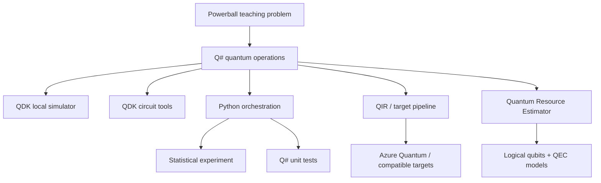

# Quantum Powerball Lab

**A practical introduction to quantum computing with Q#, Python, and the Microsoft Quantum Development Kit (QDK).**

> Can quantum computing predict the Powerball? **No.**  
> Can a Powerball generator make qubits, superposition, measurement, hybrid
> computing, testing, circuits, and resource estimation easier to understand?
> **Absolutely.**

## Why this project exists

This project modernizes an earlier Q# Powerball experiment into a teaching lab.
The lottery is deliberately familiar: five unique white balls from **1–69** and
one Powerball from **1–26**. That lets the code focus on quantum concepts instead
of an unfamiliar problem domain.

The project makes **no claim of predictive advantage**. In a fair lottery,
historical "hot" numbers do not make the next independent drawing more likely.

## The quantum idea in four lines

```qsharp
use q = Qubit();
H(q);
let result = M(q);
Reset(q);
```

Conceptually:

```text
|0> ── H ── M ──> Zero or One
       │
       └─ prepares (|0> + |1>)/√2 before measurement
```

When this project runs locally, the **QDK simulator** emulates those quantum
operations on a classical computer. The code expresses a quantum program; a
laptop does not become a quantum computer.

## Architecture



## What each feature teaches

| Feature | Concept |
|---|---|
| `QuantumRandomBit` | qubits, Hadamard gate, measurement |
| `QuantumRandomInt` | quantum measurement + classical rejection sampling |
| `GenerateQuantumTicket` | hybrid quantum/classical program structure |
| `LearningDemo` | step-by-step quantum explanation |
| `PowerballTests.qs` | modern Q# `@Test` workflow |
| `quantum_analysis.py` | Q# called from Python + statistical validation |
| `resource_estimation.py` | fault-tolerant resource-estimation workflow |

## Why rejection sampling matters

A white ball needs values 1–69. Seven measured bits can encode 128 values, so
some bit patterns fall outside the desired range. Mapping all 128 values with
a simple modulo operation would bias the distribution. Instead, the program
rejects out-of-range samples and measures again.

This is a useful example of a **hybrid algorithm**: quantum operations produce
measurement outcomes; classical logic turns those outcomes into a valid,
uniform sample.

## Run it

Prerequisites: current VS Code, Microsoft QDK extension, Python, and the current
`qdk` package.

```bash
python -m pip install --upgrade -r requirements.txt
python notebooks/run_tests.py
python notebooks/quantum_analysis.py
```

Open `src/Main.qs` in VS Code and run `Main` for Learning Mode. Learning Mode
shows the five tickets generated in the current run (newest first), with the
newest ticket highlighted as the primary quantum ticket.

## A critical distinction

**Quantum randomness ≠ quantum prediction ≠ quantum advantage.**

This project demonstrates the first. It does not claim the second or third.

Quantum advantage generally requires an algorithm whose use of superposition,
interference, entanglement, or other quantum resources produces a useful
computational benefit for a suitable problem. Random lottery selection is not
such a problem.

## From this toy problem to fault tolerance

The interesting industry challenge is much larger than generating random bits.
Useful large-scale quantum applications are expected to require **logical
qubits** protected by quantum error correction. The QDK Resource Estimator can
model how an application, hardware architecture, QEC scheme, and error budget
translate into fault-tolerant resource requirements.

`notebooks/resource_estimation.py` provides a small current-QDK example and
deliberately keeps it separate from any claim that Powerball needs fault-tolerant
quantum computing.

## Project layout

```text
quantum-powerball-lab/
├── src/Main.qs
├── tests/PowerballTests.qs
├── notebooks/
│   ├── quantum_analysis.py
│   ├── run_tests.py
│   └── resource_estimation.py
├── docs/CONCEPTS.md
├── article/ARTICLE.md
├── qsharp.json
├── requirements.txt
└── README.md
```

## Responsible framing

This is an educational sample, not gambling advice. Quantum-generated numbers
do not change the mathematical odds of a valid Powerball ticket.
